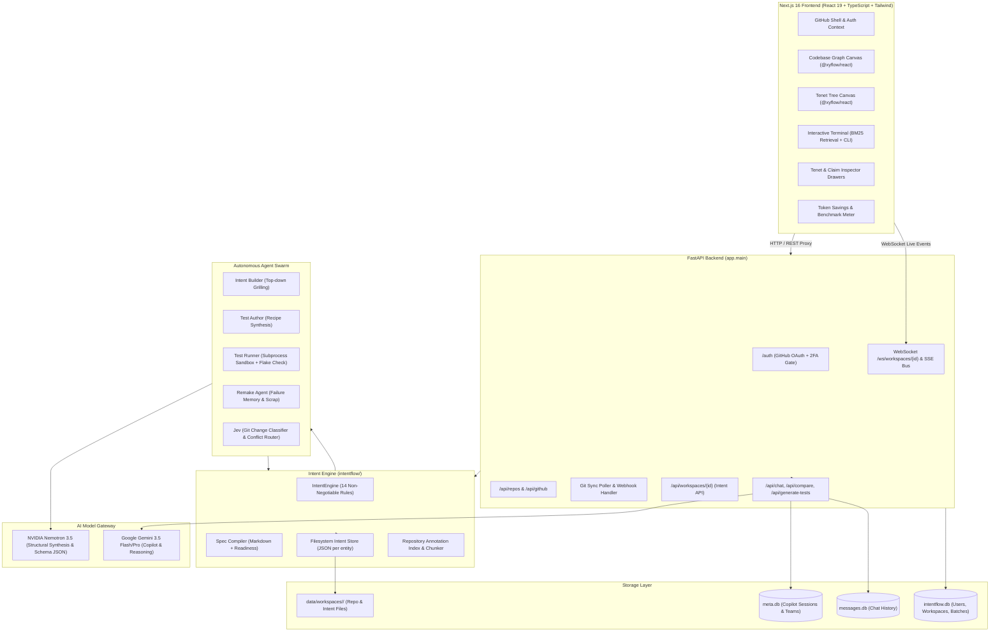
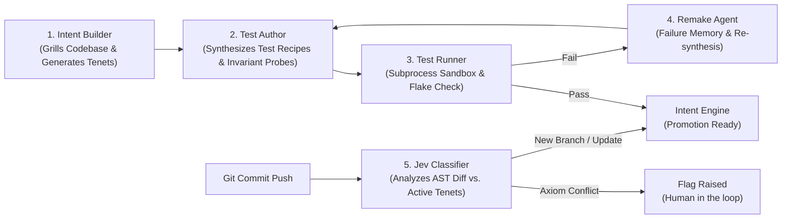

# IntentFlow — Complete Codebase Architecture & Technical Overview

> **HackUTD '26 Project**: Intent-driven legacy codebase modernization engine.  
> **Core Stack**: Next.js 16 (App Router), React 19, TypeScript, Tailwind CSS 4, `@xyflow/react`, FastAPI, Python 3.14+, SQLite, Google Gemini 3.5 Flash/Pro, NVIDIA Nemotron 3.5.

---

## Table of Contents

1. [Executive Summary & System Vision](#1-executive-summary--system-vision)
2. [End-to-End System Architecture](#2-end-to-end-system-architecture)
3. [Repository Structure & Codebase Map](#3-repository-structure--codebase-map)
4. [Core Domain Model: The Intent Specification](#4-core-domain-model-the-intent-specification)
   - [Tenets, Claims, Axioms & Hypotheses](#tenets-claims-axioms--hypotheses)
   - [The 14 Non-Negotiable Engine Rules](#the-14-non-negotiable-engine-rules)
   - [Three-Valued Logic & Verification States](#three-valued-logic--verification-states)
   - [Impact Analysis & Blast Radius](#impact-analysis--blast-radius)
5. [The Autonomous Agent Swarm](#5-the-autonomous-agent-swarm)
   - [Intent Builder (Grilling Agent)](#intent-builder-grilling-agent)
   - [Test Author Agent](#test-author-agent)
   - [Test Runner Agent & Sandboxing](#test-runner-agent--sandboxing)
   - [Remake Agent & Failure Memory](#remake-agent--failure-memory)
   - [Jev (Git Change Reviewer & Classifier)](#jev-git-change-reviewer--classifier)
   - [Spec Compiler](#spec-compiler)
6. [The 4-Step Ingestion & Git Sync Pipeline](#6-the-4-step-ingestion--git-sync-pipeline)
   - [Step 1: Code Ingestion & Disk Extraction](#step-1-code-ingestion--disk-extraction)
   - [Step 2: AST Codebase Snapshot & Import Graph](#step-2-ast-codebase-snapshot--import-graph)
   - [Step 3: Nemotron File Annotations & Tenet Generation](#step-3-nemotron-file-annotations--tenet-generation)
   - [Step 4: Interactive Tenet Grilling](#step-4-interactive-tenet-grilling)
   - [Continuous Git Synchronization (Polling & Webhooks)](#continuous-git-synchronization-polling--webhooks)
   - [Safe Export to Dedicated Branch](#safe-export-to-dedicated-branch)
7. [Agent 2: Copilot, Invariant Test Orchestrator & Dual LLM Gateway](#7-agent-2-copilot-invariant-test-orchestrator--dual-llm-gateway)
   - [Dual-Model Architecture (Gemini + Nemotron)](#dual-model-architecture-gemini--nemotron)
   - [Graph-Constrained RAG vs. Raw AST Context (70–90% Token Savings)](#graph-constrained-rag-vs-raw-ast-context-7090-token-savings)
   - [Side-by-Side Benchmark & Comparison Engine](#side-by-side-benchmark--comparison-engine)
   - [Pronoun & Multi-Turn Context Resolution](#pronoun--multi-turn-context-resolution)
8. [Frontend Architecture & Visual Experience](#8-frontend-architecture--visual-experience)
   - [Dual-View Canvas: Codebase Graph vs. Tenet Tree](#dual-view-canvas-codebase-graph-vs-tenet-tree)
   - [Interactive Browser Terminal & Command Dispatcher](#interactive-browser-terminal--command-dispatcher)
   - [Client-Side Retrieval Engine (BM25 + k-hop BFS)](#client-side-retrieval-engine-bm25--k-hop-bfs)
   - [GitHub Chrome, Repository Management & 2FA Enforcement](#github-chrome-repository-management--2fa-enforcement)
   - [Real-Time WebSocket & SSE Event Streaming](#real-time-websocket--sse-event-streaming)
9. [Database & Persistence Architecture](#9-database--persistence-architecture)
   - [Relational SQLite Schemas (`intentflow.db`, `meta.db`, `messages.db`)](#relational-sqlite-schemas)
   - [Filesystem Intent Store Layout (`data/workspaces/<id>/intent/`)](#filesystem-intent-store-layout)
10. [API Reference & System Contracts](#10-api-reference--system-contracts)
11. [Development, Configuration & Verification Guide](#11-development-configuration--verification-guide)

---

## 1. Executive Summary & System Vision

Modernizing legacy enterprise software is notorious for semantic loss: documentation is outdated, original architects have departed, and undocumented business invariants lurk inside thousands of lines of spaghetti code. Conventional LLM modernization approaches blindly dump raw syntax trees into prompts, exhausting token context windows, hallucinating edge cases, and breaking critical business invariants.

**IntentFlow** introduces an **intent-driven, invariant-governed modernization architecture**:

1. **Functional Intent Graph**: Translates raw code syntax into abstract semantic nodes defining input/output contracts, dependencies, and non-negotiable business rules.
2. **Invariant Governance (Axioms vs. Hypotheses)**: Enforces mathematical ground rules. Hypotheses can be explored and rewritten by AI agents; Axioms can *never* be altered or overwritten by autonomous models. Only human users possess the authority to promote, demote, or modify Axioms.
3. **Deterministic Invariant Testing**: Sandboxed test synthesis executing multi-pass determinism checks to eliminate test flakiness.
4. **Dual-Model AI Orchestration**: Pairs **NVIDIA Nemotron 3.5** for high-precision architectural extraction and JSON schemas with **Google Gemini 3.5** for conversational reasoning, modernization guidance, and blast-radius tracing.
5. **Graph-Constrained RAG**: Replaces massive raw AST context dumps with targeted sub-graph retrieval, achieving **70% to 90%+ token reduction** while accelerating LLM latency.

---

## 2. End-to-End System Architecture



---

## 3. Repository Structure & Codebase Map

The project is structured with root configuration and tests, while the complete application codebase resides in `my-app/`:

```
Intent-hackutd26/
├── README.md                      # Project root documentation
├── intentflow.db                  # Root SQLite database instance
├── data/                          # Workspace data storage
│   └── workspaces/<id>/           # Ingested repos and intent folders
│
└── my-app/                        # Master application workspace
    ├── package.json               # Frontend dependencies & unified scripts
    ├── next.config.ts             # Next.js configuration & FastAPI proxy rewrites
    ├── tsconfig.json              # TypeScript project settings
    ├── pytest.ini                 # Pytest pythonpath configuration (. and backend)
    │
    ├── src/                       # Next.js 16 App Router Frontend
    │   ├── app/                   # Route segments
    │   │   ├── page.tsx           # Home page: full IntentFlow Dashboard
    │   │   ├── graph/page.tsx     # Alias redirecting to /
    │   │   ├── dashboard/page.tsx # GitHub repository selector & workspace list
    │   │   ├── login/page.tsx     # GitHub OAuth sign-in & 2FA status screen
    │   │   ├── repos/[owner]/[repo]/page.tsx # Repository workbench (sync, changes, history)
    │   │   └── auth/              # Client auth route handlers (/me, /logout)
    │   │
    │   ├── gh/                    # GitHub Integration UI Components
    │   │   ├── Chrome.tsx         # GitHub-style navigation bar, breadcrumbs, user menu
    │   │   ├── Shell.tsx          # Authenticated app shell wrapper
    │   │   ├── LoginPage.tsx      # Login form with 2FA status display
    │   │   ├── DashboardPage.tsx  # Workspace cards & connection interface
    │   │   ├── RepoPage.tsx       # Repo management workbench with live polling
    │   │   ├── RepoPanel.tsx      # Tab views: changes, commit history, git diffs
    │   │   ├── IntentPanel.tsx    # Live Tenet Tree management interface
    │   │   ├── GitViews.tsx       # Commit lists, file diff renderers, line highlights
    │   │   ├── AuthContext.tsx    # React authentication context provider
    │   │   ├── api.ts             # Fetch client for GitHub & backend routes
    │   │   ├── intentApi.ts       # Typed client for /api/workspaces/{id}
    │   │   └── useWorkspaceEvents.ts # WebSocket client for real-time tree events
    │   │
    │   ├── components/            # UI Visualization & Interaction Components
    │   │   ├── Dashboard.tsx      # Master dashboard hosting Graph, Tenets, and Terminal
    │   │   ├── ChalkBoard.tsx     # Canvas wrapper component
    │   │   ├── Inspector.tsx      # Slide-out drawer inspecting codebase nodes
    │   │   ├── Terminal.tsx       # In-browser CLI and Copilot chat interface
    │   │   ├── graph/             # Codebase Graph Components
    │   │   │   ├── GraphCanvas.tsx # @xyflow/react canvas with Dagre hierarchical layout
    │   │   │   ├── ChalkEdge.tsx  # Custom SVG connection edges
    │   │   │   └── nodes.tsx      # Custom node cards with boundary badges & tokens
    │   │   ├── tenets/            # Tenet Tree Components
    │   │   │   ├── TenetCanvas.tsx # Hierarchical canvas of tenets & claims
    │   │   │   ├── TenetNode.tsx  # Tenet card with roll-up verdicts & status badges
    │   │   │   ├── TenetInspector.tsx # Deep inspection drawer for selected tenet
    │   │   │   ├── ClaimMap.tsx   # Visual map of claims and dependency links
    │   │   │   └── ClaimDetail.tsx # Detailed view of invariants, tests, and flags
    │   │   └── panel/             # Supplementary Panels
    │   │       ├── Panel.tsx      # Reusable panel container
    │   │       ├── TokenMeter.tsx # Real-time Raw vs. Intent token savings meter
    │   │       └── Guide.tsx      # Onboarding interactive guide
    │   │
    │   ├── hooks/                 # React State Hooks
    │   │   ├── useIntentGraph.ts  # Graph state, live patches, selection, filtering
    │   │   └── useTenetTree.ts    # Tenet hierarchy, claims, rollups, live updates
    │   │
    │   ├── lib/                   # Utility Libraries & Pure Algorithms
    │   │   ├── retrieval/         # Client-Side BM25 Retrieval Engine
    │   │   │   ├── engine.ts      # Tokenizer, stemmer, BM25 index, k-hop BFS expansion
    │   │   │   └── context.ts     # Markdown serialization & token cost estimation
    │   │   ├── graph/             # Graph Models & Layout
    │   │   │   ├── model.ts       # Graph indexing, boundary grouping, topological sorts
    │   │   │   └── layout.ts      # Dagre layout algorithm calculation
    │   │   ├── terminal/          # Terminal Shell Engine
    │   │   │   └── commands.ts    # 14 built-in commands (help, inspect, impact, deps...)
    │   │   ├── api/               # API Sources
    │   │   │   ├── config.ts      # Mode configuration (offline fixture vs. live HTTP)
    │   │   │   ├── httpSource.ts  # Live HTTP/WebSocket implementation
    │   │   │   ├── mockSource.ts  # Offline fixture implementation
    │   │   │   └── source.ts      # Abstract GraphSource interface
    │   │   ├── claimStyle.ts      # Visual formatting helpers for Axioms/Hypotheses
    │   │   ├── focus.ts           # Canvas focus and viewport zooming
    │   │   ├── recipe.ts          # Test recipe formatting and parsing
    │   │   └── tenetLinks.ts      # Bi-directional mapping between code nodes and tenets
    │   │
    │   └── types/intent.ts        # Shared TypeScript data contract (IntentNode, Edge, Payload)
    │
    ├── backend/                   # FastAPI Backend Application
    │   ├── requirements.txt       # Production dependencies (FastAPI, google-genai, etc.)
    │   ├── requirements-dev.txt   # Development dependencies (pytest, pytest-asyncio)
    │   ├── meta.db                # SQLite database for Copilot sessions and teams
    │   ├── messages.db            # SQLite database for Copilot message sequences
    │   │
    │   ├── app/                   # FastAPI Modules
    │   │   ├── main.py            # Application entrypoint, lifespan, CORS, router mounting
    │   │   ├── config.py          # Environment settings (OAuth, 2FA, paths, intervals)
    │   │   ├── auth.py            # GitHub OAuth flow, 2FA verification, session cookies
    │   │   ├── sessions.py        # User session management and persistence
    │   │   ├── db.py              # SQLite connection pool and schema initialization
    │   │   ├── github.py          # GitHub API endpoints (repos, branches, commits, diffs)
    │   │   ├── github_client.py   # Asynchronous httpx client for GitHub REST API
    │   │   ├── repos.py           # Workspace connection, repo listing, sync triggering
    │   │   ├── sync.py            # Continuous Git synchronization (polling & debounce)
    │   │   ├── webhooks.py        # GitHub push webhook handler with HMAC-SHA256
    │   │   ├── pipeline.py        # Ingestion pipeline: code extraction, diffing, grilling
    │   │   ├── grill.py           # Interactive Tenet Grilling session state machine
    │   │   ├── graph_view.py      # Functional Intent Graph builder (codebase + annotations)
    │   │   ├── codebase.py        # File tree scanner, language detection, AST parser
    │   │   ├── actors.py          # Actor roles and permission verification
    │   │   ├── events.py          # Async pub/sub event dispatcher for WebSocket broadcasts
    │   │   ├── errors.py          # Structured error handlers and HTTP status mapping
    │   │   │
    │   │   ├── intent/            # Workspace Intent Engine Router & Store
    │   │   │   ├── routes.py      # REST endpoints for tenets, claims, impacts, results
    │   │   │   ├── store.py       # Thread-safe IntentStore enforcing the 14 rules
    │   │   │   ├── models.py      # Pydantic schemas for intent requests and responses
    │   │   │   └── export.py      # Git Data API export to intentflow/intents branch
    │   │   │
    │   │   └── copilot/           # Agent 2: Gemini Copilot Subsystem
    │   │       ├── api/           # Copilot REST & WebSocket endpoints
    │   │       │   ├── routes.py  # /api/chat, /api/chat/compare, /api/generate-tests
    │   │       │   └── dependencies.py # Dependency injection for agents & stores
    │   │       ├── auth.py        # Current user authentication for Copilot
    │   │       ├── core/          # Interfaces (BaseLLMAgent, BaseGraphStore, BaseTestRunner)
    │   │       ├── models/schemas.py # Copilot request and response Pydantic models
    │   │       ├── services/      # Concrete services
    │   │       │   ├── llm/       # GeminiAgent & NemotronAgent implementations
    │   │       │   ├── graph/     # MemoryGraph & GraphStoreFactory
    │   │       │   ├── testing/   # PytestRunner implementation
    │   │       │   └── token_service.py # Accurate token calculation & benchmark metrics
    │   │       ├── db/            # SQLAlchemy database engines & models
    │   │       └── repositories/  # Session and message repositories
    │   │
    │   ├── scripts/               # Operational & Verification Scripts
    │   │   ├── verify_handoff.py  # Handoff verification suite (sessions, 404s, pronouns)
    │   │   ├── test_endpoints.py  # API endpoint sanity checker
    │   │   ├── smoke_test.py      # Smoke testing script
    │   │   ├── gemini_test.py     # Gemini client verification
    │   │   ├── test_nemotron_annotator.py # Nemotron model validation
    │   │   └── list_models.py     # Model discovery script
    │   │
    │   └── tests/                 # Backend Pytest Test Suites
    │       ├── test_api.py        # Auth, workspaces, and general API tests
    │       ├── test_intent.py     # Intent engine spec rules, sync, export, live events
    │       ├── test_copilot.py    # Copilot chat, compare, and test generation tests
    │       ├── test_frontend_integration.py # Frontend-backend contract wiring tests
    │       └── test_pipeline.py   # 4-step ingestion and grilling pipeline tests
    │
    ├── intentflow/                # The IntentFlow Core Engine Package
    │   ├── __init__.py            # Top-level exports
    │   ├── engine.py              # IntentEngine: rules, promotion gates, impact analysis
    │   ├── store.py               # Store: disk-backed JSON persistence & locking
    │   ├── models.py              # Data classes (Tenet, Claim, CodeLink, Verdict, Status)
    │   ├── annotations.py         # Two-pass codebase annotator & chunk hash index
    │   ├── spec_compiler.py       # Requirements spec compiler (Markdown + readiness)
    │   ├── jobs.py                # Async background job executor & SSE Event Bus
    │   ├── llm.py                 # Nemotron client with tiers, thinking flags, retries
    │   ├── tools.py               # Tool registry & Gemini-compatible declarations schema
    │   │
    │   └── agents/                # Autonomous Agent Swarm Implementation
    │       ├── intent_builder.py  # Top-down grilling & tenet tree authoring
    │       ├── test_author.py     # Test recipe authoring & Axiom boundary probing
    │       ├── test_runner.py     # Sandboxed test runner & determinism checker
    │       ├── remake.py          # Failure memory & scrap-and-remake agent
    │       └── jev.py             # Git change reviewer & type-safe classifier
    │
    └── tests/                     # Top-Level Engine Tests
        └── test_engine.py         # Asserting the 14 non-negotiable rules
```

---

## 4. Core Domain Model: The Intent Specification

The Intent Specification (`CONTEXT.md` / `my-app/README.md`) defines a rigorous mathematical framework for representing software intent.

### Tenets, Claims, Axioms & Hypotheses

```
              [Root System Tenet]
                      │
       ┌──────────────┴──────────────┐
       ▼                             ▼
[Auth Subsystem]             [Payment Subsystem]
  (Tenet)                       (Tenet)
   ├── ◆ Axiom 1 (Immutable)     ├── ◆ Axiom 3 (Immutable)
   ├── ◇ Hypothesis 1 (Active)   └── ◇ Hypothesis 2 (Unverified)
   └── [CodeLinks: session.py]
```

1. **Tenets (`Tenet`)**:
   - Represents a capability, subsystem, or boundary in the system.
   - Organised in a strict ownership tree with exactly **one root**.
   - Can declare **composition references** (`references`) to peer or descendant tenets without creating directed cycles.
   - **Leaf tenets** bind directly to source code files via `CodeLink` (file path, start/end lines, symbol, chunk hash).
   - Higher-level tenets do not carry code links directly; their footprint is dynamically rolled up from their children.

2. **Claims (`Claim`)**:
   - Discrete, testable statements of invariant behavior associated with a Tenet.
   - Carries a statement, a plain-language test explanation, and an executable test recipe.
   - May declare `dependencies` pointing to prerequisite claims.

3. **Hypothesis (`◇ status = "hypothesis"`)**:
   - A provisional statement synthesized by an agent or human.
   - Autonomous agents (`builder`, `engine`) can freely create, revise, or scrap Hypotheses.

4. **Axiom (`◆ status = "axiom"`)**:
   - Non-negotiable ground truth.
   - **Rule 1**: Autonomous agents can **never** modify, create, or demote an Axiom. Only verified human users (`Actor.USER`) hold authority over Axioms.

---

### The 14 Non-Negotiable Engine Rules

These rules are enforced strictly in Python code (`backend/app/intent/store.py` and `intentflow/engine.py`), never left to probabilistic prompt instructions:

| # | Rule Name | Description & Enforcement |
|---|---|---|
| **1** | **Axiom Immutability** | Agents attempting to create, edit, or delete an Axiom receive immediate `403 PERMISSION_DENIED`. |
| **2** | **Promotion Gate** | A Hypothesis can only be promoted to an Axiom if it has a passing, non-flaky test result for its exact content hash, and all upstream dependencies are passing Axioms. |
| **3** | **Override Badging** | A user may promote a claim without a passing test via `accept_without_verification=True`; the UI permanently badges the claim as unverified. |
| **4** | **Demotion Ripple** | Demoting an Axiom requires a mandatory reason, creates a snapshot in `history/`, flags all downstream dependent claims, and marks their test results `STALE`. |
| **5** | **Human Authority Minting** | Sensitive operations require a `UserAuthority` token that can only be minted by verified GitHub session cookies in the auth layer. |
| **6** | **Deterministic Hash Binding** | Test results bind immutably to `claim_hash = sha256(statement + test_explanation + test_implementation)`. Any text revision instantly renders previous results stale. |
| **7** | **Strict Single Root** | The Tenet hierarchy allows exactly one root tenet (`parent_id = null`). All other tenets must trace ancestry to the root. |
| **8** | **Acyclic References** | Directed references across tenets are topologically validated; any reference introducing a cycle is rejected with `CYCLE_DETECTED`. |
| **9** | **Leaf-Only Code Links** | Source file bindings (`CodeLink`) are permitted exclusively on leaf tenets. |
| **10** | **Undeletable Axiom Containers** | A Tenet holding Axioms, having child tenets, or referenced by other tenets cannot be deleted. |
| **11** | **Deterministic Test Execution** | The Test Runner executes test recipes in isolated subprocess sandboxes, re-running potentially flaky tests 3 times across 2 temporary directories. |
| **12** | **Jev Non-Disruption Gate** | The Jev change reviewer cannot apply updates directly to Axioms. Incoming commits that conflict with an Axiom trigger an `axiom_conflict` flag. |
| **13** | **Failure Memory (Scrap & Remake)** | When a Hypothesis fails and is scrapped, its interpretation is recorded in `history/rejected_interpretations.json`. Remake agents must prove divergence from all rejected interpretations. |
| **14** | **Two-Phase Axiom Hand Editing** | Direct hand-edits to Axiom statements return `428 CONFIRMATION_REQUIRED` alongside an impact blast-radius summary, requiring explicit user confirmation before committing. |

---

### Three-Valued Logic & Verification States

IntentFlow avoids binary true/false assumptions. Verification is modeled using three-valued logic:

- `PASS`: Test executed successfully against the target code commit with deterministic outputs.
- `FAIL`: Execution asserted an invariant violation; indicates either broken code or an invalid hypothesis.
- `INCONCLUSIVE`: Test could not definitively prove or disprove the invariant (e.g., missing mock environment, external network timeout). **Inconclusive results never count as passing.**
- `STALE`: The underlying claim wording, code chunk, or dependency was modified since the last test run.
- `UNTESTED`: A newly created hypothesis awaiting test execution.

---

### Impact Analysis & Blast Radius

Before any Claim is edited or demoted, the engine computes a comprehensive impact graph via `GET /api/workspaces/{id}/claims/{claim_id}/impact`:

```json
{
  "claim_id": "c_7a1b9c",
  "dependent_claims": [
    { "id": "c_2e3f4a", "tenet_id": "t_auth", "status": "hypothesis", "statement": "Session token must be signed by JWT secret" }
  ],
  "integration_claims_above": [
    { "id": "c_9b8a7c", "tenet_id": "t_root", "status": "axiom" }
  ],
  "referencing_tenets": ["t_payments"],
  "affected_tenets": ["t_auth", "t_root"],
  "linked_code": [{"path": "src/auth/session.py"}],
  "results_going_stale": ["c_2e3f4a"],
  "spec_sections_provisional": ["Authentication & Authorization"]
}
```

---

## 5. The Autonomous Agent Swarm

IntentFlow features five autonomous specialized agents operating under the strict supervision of the `IntentEngine`.



### Intent Builder (Grilling Agent)
- **Role**: Top-down codebase interrogation and requirement generation.
- **Workflow**:
  1. Inspects the file tree, language breakdown, and AST import graphs.
  2. Formulates structured clarification questions (`GQuestion`: `text`, `why`, `options`).
  3. Synthesizes the root Tenet, subsystem Tenets, and candidate invariant Hypotheses.

### Test Author Agent
- **Role**: Crafts comprehensive, deterministic test recipes.
- **Recipe Structure**: Each test recipe is structured into strict sections:
  `ENV/SETUP`, `FIXTURES`, `INVOKE`, `ASSERT`, `EXPECTED`, `TEARDOWN`, `PASS WHEN`, `FAIL WHEN`, `INCONCLUSIVE WHEN`.
- **Axiom Probing**: When an Axiom is scrutinized, generates 3–5 edge-case probe hypotheses (`ProbeHypotheses`) to stress-test boundary invariants.

### Test Runner Agent & Sandboxing
- **Role**: Sandboxed execution and determinism validation.
- **Isolation (`SubprocessSandbox`)**: Clones the workspace repository to an isolated temporary directory (`/tmp/intentflow_run_...`) to protect the host environment.
- **Flakiness Check**: Executes the test 3 times across 2 distinct temporary directories. If outputs disagree, the result is marked `flaky = True`, blocking promotion to Axiom status.
- **DAG Execution**: Resolves claim dependencies topologically, running prerequisites before downstream integration tests.

### Remake Agent & Failure Memory
- **Role**: Self-healing hypothesis regeneration without regression.
- **Mechanism**: When a hypothesis fails, the Remake Agent scraps it and appends the failed mental model to `history/rejected_interpretations.json`.
- **Divergence Constraint**: Replacement hypotheses must demonstrate semantic distance from previous failures, preventing LLMs from looping on the same incorrect assumptions.

### Jev (Git Change Reviewer & Classifier)
- **Role**: Type-safe routing of git changes into the intent hierarchy.
- **Verdict Types**:
  - `no_disruption`: Change is purely refactoring or cosmetic; all invariants remain intact.
  - `update_existing`: Safe changes to existing hypotheses or implementation code.
  - `new_branch`: Introduction of new features requiring new Tenets.
  - `axiom_conflict`: Commit alters behavior guaranteed by an Axiom. **Immediately flags the claim and halts automated acceptance until a human reviews the conflict.**

### Spec Compiler
- **Role**: Compiles active Tenets, Axioms, and verified CodeLinks into a production-grade markdown specification document.
- **Output**: Generates sections, subsections, requirement lists, test coverage statuses, known unknowns, and architectural readiness metrics.

---

## 6. The 4-Step Ingestion & Git Sync Pipeline

When a GitHub repository is connected to IntentFlow, the automated pipeline in `backend/app/pipeline.py` executes four discrete phases:

```
[Connect Repo] ──> Step 1: Pull Code to Disk
               ──> Step 2: AST Diff & Import Graph
               ──> Step 3: Nemotron Annotation & Tenet Synthesis
               ──> Step 4: Interactive Tenet Grilling Session
```

### Step 1: Code Ingestion & Disk Extraction
- Downloads the repository tarball from GitHub (`/repos/{owner}/{repo}/tarball/{sha}`).
- Extracts source files to the workspace disk directory: `data/workspaces/<id>/repo/`.

### Step 2: AST Codebase Snapshot & Import Graph
- Recursively parses source code using `app.codebase`.
- Discovers internal import edges (`source -> target`), package boundaries, and external library dependencies (e.g., `react`, `fastapi`).
- Calculates structural line counts and token approximations.

### Step 3: Nemotron File Annotations & Tenet Generation
- Dispatches source files to **NVIDIA Nemotron 3.5**.
- Generates structured architectural annotations conforming to schema:
  - `purpose`: 2–3 sentence architectural role summary.
  - `responsibilities`: List of concrete functions and state updates.
  - `invariants`: Non-negotiable architectural constraints.
  - `dependencies` & `sections`: Import lists and structural segments.
- Automatically clusters source files into subsystems, creating the **Root System Tenet**, subsystem **Leaf Tenets**, and initial **Invariant Claims**.
- Compiles the initial requirements specification in `spec/compiled.json`.

### Step 4: Interactive Tenet Grilling
- Initializes a tenet clarification interview session (`data/workspaces/<id>/intent/.sessions/grill_ws_<id>.json`).
- Formulates multi-choice architectural clarification questions presented in the UI terminal or copilot chat.

### Continuous Git Synchronization (Polling & Webhooks)
- **Background Polling Daemon**: When a user opens a repository page, a polling task (`app.sync`) queries GitHub every 30 seconds (`POLL_INTERVAL_SECONDS`). When new commits arrive, it computes line-level diffs (`changed_lines: {added: [[start, end]], removed: [...]}`) and notifies the Jev classifier. Polling automatically ceases after 30 minutes of inactivity (`POLL_IDLE_STOP_SECONDS`).
- **Webhook Handler**: Listens at `/webhooks/github` with HMAC-SHA256 signature verification. Incoming pushes within 20 seconds (`SYNC_DEBOUNCE_SECONDS`) are debounced into a single atomic sync batch.

### Safe Export to Dedicated Branch
- The user can export the intent model directly back to GitHub (`POST /api/workspaces/{id}/export`).
- Utilizes the **GitHub Git Data API** (`git/trees`, `git/commits`, `git/refs`) to commit the intent folder directly to `.intentflow/` on the dedicated `intentflow/intents` branch.
- **Non-Pollution Guarantee**: The export engine *never* writes to the default branch (`main` / `master`), and automatically gitignores local execution results.

---

## 7. Agent 2: Copilot, Invariant Test Orchestrator & Dual LLM Gateway

The Copilot subsystem (`backend/app/copilot/`) provides an interactive coding and modernization partner.

### Dual-Model Architecture (Gemini + Nemotron)
- **Google Gemini 3.5 Flash / Pro**: Powers conversational assistance, invariant query answering, blast-radius exploration, and multi-step modernization reasoning.
- **NVIDIA Nemotron 3.5**: Powers deep structural file analysis, chunk hashing, and structured JSON schemas.

### Graph-Constrained RAG vs. Raw AST Context (70–90% Token Savings)
Traditional coding assistants pass entire directory trees into prompts. IntentFlow leverages the **Functional Intent Graph** to pass only relevant intent nodes, their business invariants, and input/output contracts.

```
┌──────────────────────────────────────────────────────────┐
│ Raw Context Baseline:                                    │
│ 15 source files, full implementations = ~48,000 tokens   │
└──────────────────────────────────────────────────────────┘
                            vs.
┌──────────────────────────────────────────────────────────┐
│ IntentFlow Graph-Constrained Context:                    │
│ 3 intent nodes, 8 business invariants = ~4,200 tokens    │
│ => 91.25% Token Reduction | 3.4x Faster Latency          │
└──────────────────────────────────────────────────────────┘
```

### Side-by-Side Benchmark & Comparison Engine
The endpoint `POST /api/chat/compare` runs a live dual benchmark:
1. **Raw Bot**: Queries Gemini with raw source code files.
2. **Intent Bot**: Queries Gemini using graph-constrained semantic nodes.
3. **Metrics Output**: Returns side-by-side responses, exact token counts (`tokens_raw`, `tokens_intent`), latency in milliseconds, and the calculated `percentage_saved`.

### Pronoun & Multi-Turn Context Resolution
Conversations are persisted in `messages.db` and scoped by session in `meta.db`. The agent includes regex-based pronoun resolution (`PRONOUN_RE = \b(it|its|that|this|those|them|they)\b`):
- If a user asks *"What business invariants protect payment processing?"* followed by *"What depends on it?"*, the agent automatically anchors the pronoun `"it"` back to the payment processing node from conversation history.

---

## 8. Frontend Architecture & Visual Experience

The frontend is a client-rendered application built on **Next.js 16 (App Router)**, **React 19**, and **Tailwind CSS 4**.

### Dual-View Canvas: Codebase Graph vs. Tenet Tree

```
┌─────────────────────────────────────────────────────────────────────────┐
│ [Codebase (Graph)]  [Tenets (Tree)]                   [Sync]  [Export]  │
├─────────────────────────────────────────┬───────────────────────────────┤
│                                         │ Inspector Drawer              │
│  ┌──────────────┐     ┌──────────────┐  │ ───────────────────────────── │
│  │ auth_flow    │────>│ payment_node │  │ Node: payment_node            │
│  │ ◆2 ◇1        │     │ ◆3 ◇0        │  │ Invariants:                   │
│  └──────────────┘     └──────────────┘  │ • Amount must be > 0          │
│                                         │ • Card tokenization required  │
├─────────────────────────────────────────┴───────────────────────────────┤
│ Terminal / Copilot CLI:                                                 │
│ > query payment                                                         │
│ [Hit: payment_node score=8.4 hop=0]                                     │
└─────────────────────────────────────────────────────────────────────────┘
```

1. **Codebase Graph Canvas (`GraphCanvas.tsx`)**:
   - Built with `@xyflow/react` and layouted with `@dagrejs/dagre`.
   - Nodes represent functional modules grouped into dashed boundary containers (`boundaryOf`).
   - Cards display node status badges (e.g. `◆2 ◇1`), token weights, and dependency arrows.
2. **Tenet Tree Canvas (`TenetCanvas.tsx`)**:
   - Visualizes the strict hierarchical ownership tree of tenets.
   - Shows roll-up verdicts (`pass`, `fail`, `stale`) and axiom health indicators.

### Interactive Browser Terminal & Command Dispatcher
The in-browser terminal (`Terminal.tsx`, `commands.ts`) accepts both slash commands and natural language:
- Built-in commands: `help`, `inspect <id>`, `query <term>`, `invariants <id>`, `deps <id>`, `impact <id>`, `path <from> <to>`, `ls`, `context <id>`, `tests <id>`, `reset`, `fit`, `sync`, `clear`.
- Free text queries automatically trigger BM25 retrieval and forward the enriched context to the Copilot agent via `POST /api/repos/{repo}/ask`.

### Client-Side Retrieval Engine (BM25 + k-hop BFS)
Implemented in `src/lib/retrieval/engine.ts` with zero React dependencies:
1. **Lexical Seeding (BM25)**: Tokenizes camelCase, snake_case, and file paths. Applies stemming and matches query tokens against weighted node fields:
   `id: 3.0`, `name: 3.0`, `intent_summary: 2.0`, `business_invariants: 1.5`, `inputs/outputs: 1.2`, `source_file: 1.0`.
2. **Graph Expansion (k-hop BFS)**: Expands outward from seed nodes (default 1 hop) with a 0.5 score decay factor per hop.
3. **Context Budgeting**: Truncates results to the top `maxNodes` (default 8) to maintain strict token constraints.

### GitHub Chrome, Repository Management & 2FA Enforcement
- **Chrome Shell (`Chrome.tsx`, `Shell.tsx`)**: Replicates GitHub navigation with repository tabs, branch badges, and user avatars.
- **Mandatory 2FA**: In accordance with enterprise security standards, `auth.py` checks `two_factor_authentication` on GitHub profiles. Accounts without 2FA are rejected with `2fa_required` status.
- **Git Views (`GitViews.tsx`, `RepoPanel.tsx`)**: Renders line-level diffs with syntax styling and commit history timelines.

### Real-Time WebSocket & SSE Event Streaming
- Connects to `/ws/workspaces/{id}` via `useWorkspaceEvents.ts`.
- Streams live events directly into the UI:
  - `sync.batch`: Informs user of incoming commits or finished ingestion.
  - `jev.verdict`: Displays Jev classification results.
  - `result.appended`: Updates test pass/fail indicators in real time.
  - `flag.raised`: Alerts the user when an Axiom is contested or a dependency is broken.

---

## 9. Database & Persistence Architecture

IntentFlow uses a hybrid storage strategy: **relational SQLite databases** for structured transactional state and a **filesystem JSON store** for the versioned intent graph.

```
Persistence Architecture:
├── intentflow.db (SQLite)       ──> Users, GitHub tokens, Repositories, Sync batches, Webhooks
├── meta.db (SQLite / SQLAlchemy) ──> Teams, Copilot Chat Sessions, Workspace metadata
├── messages.db (SQLite / SQLAlchemy) ──> Chronological chat message sequences & roles
└── data/workspaces/<id>/intent/ ──> JSON file-per-entity Intent Store (Git-exportable)
```

### Relational SQLite Schemas

#### 1. `intentflow.db` (`backend/app/db.py`)
- `users`: GitHub user credentials, login timestamps.
- `repos`: Connected workspaces, default branches, `last_synced_sha`.
- `push_events`: Raw GitHub push payloads and webhook deliveries.
- `sync_batches`: Grouped, debounced synchronization batches.
- `sessions`: Active browser session cookies.

#### 2. `meta.db` (`backend/app/copilot/db/models.py`)
- `users` & `teams`: Team membership and RBAC permissions.
- `chat_sessions`: Copilot chat sessions, titles, active node selections, message counters.

#### 3. `messages.db` (`backend/app/copilot/db/models.py`)
- `messages`: Message role (`user` | `assistant`), content text, timestamps, sequential ordering (`seq`).

### Filesystem Intent Store Layout
Located at `data/workspaces/<id>/intent/`:
```
data/workspaces/<id>/intent/
├── tenets/                       # One JSON file per Tenet (<tenet_id>.json)
├── claims/<tenet_id>/            # Claims partitioned by Tenet (<claim_id>.json)
├── results/                      # Append-only test run records (<claim_id>.json)
├── annotations/                  # Nemotron architectural annotations (<path>.json)
├── links/                        # Code links, AST import edges, reverse indexes
├── history/                      # Axiom snapshots, scrapped hypotheses, rejected interpretations
├── spec/                         # Compiled specification (compiled.json, spec.md)
└── changelog/changelog.jsonl     # Append-only audit trail of Jev verdicts and user edits
```

---

## 10. API Reference & System Contracts

### Workspace Intent Endpoints (`/api/workspaces/{id}`)

| Method | Path | Allowed Caller | Purpose |
|---|---|---|---|
| `GET` | `/tree` | All | Fetch full Tenet hierarchy, claims, rollups, and flags |
| `POST` | `/tenets` | User, Builder, Engine | Create a new Tenet (`parent_id = null` for root) |
| `GET` | `/tenets/{id}` | All | Retrieve Tenet details, footprint, and open unknowns |
| `PATCH` | `/tenets/{id}` | User, Builder, Engine | Edit Tenet name or functionality |
| `DELETE` | `/tenets/{id}` | User, Builder, Engine | Delete Tenet (blocked if holding Axioms or children) |
| `POST` | `/tenets/{id}/move` | User, Builder, Engine | Reparent Tenet (ownership move) |
| `POST` | `/tenets/{id}/references` | User, Builder, Engine | Add composition reference (cycle-checked) |
| `PUT` | `/tenets/{id}/links` | Engine | Bind source code files to leaf Tenet |
| `POST` | `/tenets/{id}/claims` | User, Builder, Engine | Create a new Hypothesis |
| `GET` | `/claims/{id}` | All | Retrieve Claim details, test recipe, and results |
| `PATCH` | `/claims/{id}` | User, Builder, Engine | Update Hypothesis statement (Axioms refused) |
| `PUT` | `/claims/{id}/axiom` | User | Hand-edit an Axiom (requires 428 impact preview confirmation) |
| `GET` | `/claims/{id}/impact` | All | Compute downstream blast-radius and dependent ripple |
| `POST` | `/claims/{id}/promote` | User | Promote Hypothesis to Axiom (verifies test result and DAG) |
| `POST` | `/claims/{id}/demote` | User | Demote Axiom to Hypothesis (snapshots state, flags dependents) |
| `POST` | `/claims/{id}/scrap` | User, Builder | Scrap invalid Hypothesis |
| `POST` | `/claims/{id}/remake` | User, Builder | Regenerate Hypothesis using failure memory |
| `POST` | `/claims/{id}/results` | Test Runner | Append test run execution result |
| `GET` | `/codebase` | All | Fetch folder tree, files, annotations, and import edges |
| `POST` | `/export` | User | Commit intent folder to `intentflow/intents` branch |
| `WS` | `/ws/workspaces/{id}` | All | Live WebSocket event stream |

### Copilot & Orchestration Endpoints (`/api`)

| Method | Path | Purpose |
|---|---|---|
| `POST` | `/api/chat` | Chat with Copilot using graph-constrained context and session memory |
| `POST` | `/api/chat/compare` | Dual benchmark: Raw AST context vs. IntentFlow Graph context |
| `POST` | `/api/generate-tests` | Synthesize deterministic pytest / Jest tests from invariant nodes |
| `POST` | `/api/run-tests` | Execute invariant test suite in isolated environment |
| `POST` | `/api/extract-intent` | Extract intent, invariants, and dependencies from arbitrary code |
| `GET` | `/api/graph` | Return current Functional Intent Graph payload |
| `GET` | `/api/nodes/{id}/blast-radius` | Calculate downstream dependency blast radius |
| `GET` | `/api/metrics/summary` | Query cumulative token savings and benchmark metrics |
| `GET` | `/api/sessions` | List active user chat sessions |
| `GET` | `/api/sessions/{id}/messages` | Retrieve conversation history for session |

---

## 11. Development, Configuration & Verification Guide

### Prerequisites
- Python 3.14+ (or Python 3.11+)
- Node.js 18+ (Node 20+ recommended)
- GitHub OAuth Application (Client ID & Client Secret)
- Optional: Google Gemini API Key (`GEMINI_API_KEY`) & NVIDIA API Key (`NVIDIA_API_KEY`)

### Environment Setup

1. **Backend Configuration (`my-app/backend/.env`)**:
   ```bash
   cp my-app/backend/.env.example my-app/backend/.env
   ```
   Key variables:
   ```env
   GITHUB_CLIENT_ID=your_github_client_id
   GITHUB_CLIENT_SECRET=your_github_client_secret
   GITHUB_OAUTH_SCOPES="read:user repo"
   OAUTH_REDIRECT_URI=http://localhost:8000/auth/github/callback
   FRONTEND_URL=http://localhost:3000
   REQUIRE_GITHUB_2FA=true

   # Model Keys
   GEMINI_API_KEY=your_gemini_api_key
   GEMINI_MODEL=gemini-3.5-flash
   NVIDIA_API_KEY=your_nvidia_api_key
   NVIDIA_MODEL=nvidia/nemotron-3.5-lightning-30b-a3b

   # Storage & Sync
   DATA_DIR=data
   DATABASE_PATH=intentflow.db
   POLL_INTERVAL_SECONDS=30
   POLL_IDLE_STOP_SECONDS=1800
   ```

2. **Frontend Configuration (`my-app/.env.local`)**:
   ```bash
   cp my-app/.env.example my-app/.env.local
   ```
   ```env
   BACKEND_URL=http://localhost:8000
   NEXT_PUBLIC_INTENTFLOW_API=/api
   NEXT_PUBLIC_INTENTFLOW_WS=ws://localhost:8000
   ```

### Running the System

```bash
# Install frontend dependencies
cd my-app
npm install

# Install backend dependencies
cd backend
pip install -r requirements.txt -r requirements-dev.txt
cd ..

# Run both frontend and backend concurrently
npm run dev:all

# Or run separately:
npm run dev:api    # FastAPI server on http://localhost:8000
npm run dev        # Next.js server on http://localhost:3000
```

### Running the Test Suite
The repository includes a comprehensive test suite covering all 14 engine rules, API contracts, frontend integration, and the 4-step pipeline:

```bash
# Run complete test suite (from my-app/)
npm run test:api

# Or directly using pytest
cd my-app
python3 -m pytest
```

### Verification Scripts
Located in `my-app/backend/scripts/`:
- `python3 backend/scripts/verify_handoff.py`: Verifies Copilot sessions, 404 handling, and multi-turn pronoun resolution.
- `python3 backend/scripts/smoke_test.py`: Runs a rapid health and endpoint availability check.
- `python3 backend/scripts/gemini_test.py`: Verifies Gemini API key connectivity and response generation.
- `python3 backend/scripts/test_nemotron_annotator.py`: Validates Nemotron architectural annotation synthesis.
